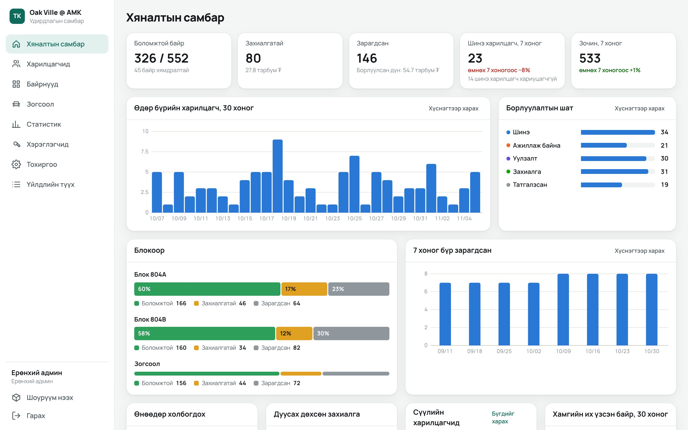

# 3D Байр Сонголт: interactive 3D property showroom

[Монгол хэлээр](./README.mn.md)

A buyer explores a residential project in the browser, picks a block, floor and flat, looks around the furnished rooms at any time of day, then books a viewing or leaves a phone number. The sales team works those leads, sets every flat's status and price, and sees what buyers look at, in an admin panel.

The sample project is Oak Ville @ AMK (Blocks 804A and 804B, 552 flats). Everything comes from data, so a new project needs new data files and assets, not code changes.

## Run it

After cloning, double-click `start.bat` on Windows, or run `./start.sh` on Mac or Linux. It downloads the 3D files, installs the libraries, turns on auto-sync and opens http://localhost:5173. The admin panel starts with it at http://localhost:5175/admin/; the first time, create your account with the setup code the window prints. Its database stays on that computer in `data/` (not synced, since it holds buyers' numbers), so each computer has its own until it is online (see below). Add `--no-admin` to start only the showroom. The only requirements are Git with [Git LFS](https://git-lfs.com) and Node 22 or newer; on Windows, `start.bat` installs Node if it is missing.

Run by hand, it is `pnpm install` and then `pnpm dev`. If PowerShell says running scripts is disabled, type `pnpm.cmd` instead of `pnpm`. For the marketing site, run `pnpm dev:website`. For the admin panel, run `pnpm dev:admin` (see below).

| Command | What it does |
|---|---|
| `pnpm test` | Unit tests: pricing, availability, clearances, hotspots, routing, render data |
| `pnpm typecheck` | TypeScript across every package |
| `pnpm lint` | ESLint |
| `pnpm build` | Builds the apps into `dist/`: the website at `/`, the showroom at `/showroom/`, the admin panel at `/admin/` |
| `pnpm dev:admin` | The API on :8787 and the admin panel on http://localhost:5175/admin/ |
| `pnpm dev:all` | The same, plus the showroom and the website sending leads and statistics to the local API |
| `pnpm demo:data` | Fills the local database with made-up buyers, sales and six weeks of visits (local only) |
| `pnpm cf:setup`, `pnpm cf:deploy` | Puts everything online on Cloudflare's free plan (see below) |
| `pnpm build:online`, `pnpm start:server` | Builds everything for one address and serves it, with the API, from this computer |
| `pnpm --filter @bair/showroom e2e` | Browser test of the buying flow against a running dev server (needs Edge or Chrome) |
| `pnpm --filter @bair/showroom assets` | Re-downloads and re-compresses the CC0 assets |

Deep links work everywhere: `#/804A`, `#/804A/12`, `#/804A/12/325`, `#/804A/12/325/living-1`, `#/outdoor/playground`. Add `?t=18:30` for a time of day.

Dev pages: `?debug=1` in a flat shows the measured plan with clearances, `#/dev/plan/4R` compares a flat's top view with its plan, and `#/dev/export` exports for Unreal.

## Layout

| Folder | What is in it |
|---|---|
| `apps/showroom` | The 3D app |
| `apps/website` | Placeholder marketing site |
| `apps/admin` | The admin panel (React), served at `/admin/` |
| `apps/api` | The API behind the admin panel: Cloudflare Worker with D1, or Node with SQLite on a computer |
| `packages/project-data` | Project config, data, interiors, pricing, availability, Mongolian text. No 3D code, so a backend can reuse it |
| `packages/ui` | Shared glass panel |
| `unreal` | Photoreal render pipeline, see [its README](./unreal/README.md) |
| `reference` | Source drawings and the interior design PDF |
| `docs` | Interior notes, Blender guide, review screenshots |
| `vault` | Obsidian notes: current focus, session notes, decisions, ideas |

## Add a new project

Everything lives in `packages/project-data/src`:

1. `data/project.config.ts`: name, developer, contact details, accent colour, latitude and longitude, time zone, price per m², floor premium, bay price.
2. `data/blocks.ts`: blocks and the stacks on each floor.
3. `data/unitTypes.ts` and `interiors/`: one file per flat type with rooms, doors, windows, furniture, lights and hotspots. Run `pnpm test` and the clearance checks report anything that doesn't fit. Furniture is never scaled to fit: record a real conflict in `interiors/exceptions.ts`.
4. `data/site.ts`, `data/outdoor.ts`, `data/garage.ts`, `data/cameras.ts`: amenities, outdoor standing points, parking and named cameras.
5. `i18n/mn.ts`: labels. To add a language, copy this file to `en.ts` and translate the values.

## Admin panel

The sales team's side of the project, in Mongolian, at `/admin/`:

- **Хяналтын самбар (dashboard):** flats available, reserved and sold with their value, new leads and visitors this week against last week, leads per day, the sales pipeline, each block's status split, sales per week, today's follow-ups, reservations about to run out, the latest leads and the most viewed flats.
- **Харилцагчид (leads):** every request from the showroom and the website, and buyers who phoned or walked in, added by hand. Filter by stage, source, salesperson, date or follow-ups due, and search names, numbers and flats. Work them in a table or on a board by stage (drag a card to move it): new, in progress, meeting, order, lost. Each lead has a salesperson, a next-step date, a timeline of notes and changes, the path the buyer took through the showroom before asking, and other requests from the same number. One button reserves or sells the buyer's flat.
- **Байрнууд (flats):** a floor-by-stack grid of each block, coloured by status, by interest (how many visitors looked at each flat) or by type. Pick flats one by one, by rectangle, by floor or by stack, then change their status, put them on sale by a percentage until a date, end a sale, or move list prices up or down. Each flat has its own page: status, reservation date, the lead it is reserved for, a hand-set list price or a fixed sale price, a note, its history and its leads. The showroom shows the new status colours and sale prices (old price struck through) within two minutes.
- **Зогсоол (parking):** the same for the 272 garage bays.
- **Статистик (analytics):** visitors per day, a heat map of interest per floor of each block, the most viewed flats, blocks, flat types, rooms and outdoor spots, devices, hours of the day, actions (plan opened, call, share) and the path from opening the showroom to sending a request. Every chart has a table view.
- **CSV and Excel exports** of leads (with the current filters), flats, bays and analytics.
- **Хэрэглэгчид, Тохиргоо, Үйлдлийн түүх:** user accounts, the base price per m², floor premium and bay price, changing your password, and a log of who changed or exported what.

More screenshots (made-up demo data): [flat grid](docs/admin/units.jpg), [leads board](docs/admin/leads-board.jpg), [a lead](docs/admin/lead.jpg), [analytics](docs/admin/analytics.jpg), [flat grid on a phone](docs/admin/phone-units.jpg).

| Role | Can |
|---|---|
| Ерөнхий админ (superadmin) | Everything, including users, base prices, deleting leads and the audit log |
| Админ (admin) | Leads, flat and bay status, prices and sales, exports |
| Борлуулалтын ажилтан (sales) | Work every lead (leads they add are assigned to them), and look at flats, parking and analytics |

The first time, the panel asks for a setup code and creates the first superadmin. `pnpm dev:admin` prints the code in the terminal; on Cloudflare, `pnpm cf:deploy` prints it. If nobody can sign in any more, `pnpm --filter @bair/api user password <email>` sets a new password (add `--sql` for the SQL to run on Cloudflare).

Passwords never leave the browser as typed: it stretches them with PBKDF2 (600,000 rounds) and the server keeps only a hash of the result. Sessions are HttpOnly cookies for `/api`, five wrong passwords lock an account for 15 minutes, and the panel's writes carry a header other sites cannot send.

Visit statistics are anonymous: a random id per browser tab, no cookies, and nothing is recorded for visitors whose browser asks not to be tracked.

## Put it online for free

Cloudflare's free plan runs everything with no credit card: the website, the showroom and the admin panel as static files (free and unmetered), and the API as a Worker with a D1 database. Nothing in the project calls a paid service.

1. Create a free account at https://dash.cloudflare.com/sign-up.
2. `pnpm cf:setup` signs in (a browser window opens) and creates the database. Commit the database id it writes into `apps/api/wrangler.jsonc`.
3. `pnpm cf:deploy` builds everything and publishes it. It prints the address (`https://bair-songolt.<your-name>.workers.dev`) and, the first time, the setup code for the first admin account at `/admin/`.

Run `pnpm cf:deploy` again whenever you want the latest code online. A custom domain can be added in the Cloudflare dashboard (Workers → bair-songolt → Domains).

The free plan's daily limits are 100,000 requests to the API, 5 million rows read and 100,000 rows written. The API is built to stay well inside them: a showroom visitor costs a handful of requests, statistics are kept as daily counters, and analytics may use at most 60,000 writes a day, so leads can always be saved. If a very busy day reaches that cap, statistics stop counting until midnight UTC and leads keep working.

To keep the 3D files on GitHub Pages instead, set the repository variable `API_URL` to the Cloudflare address before running the Pages deploy; the showroom and website then send leads and statistics there.

**On your own computer instead:** `pnpm build:online` and then `pnpm start:server` serve the sites, the admin panel and the API on http://localhost:8787, with the database in `data/bair.sqlite` (kept out of Git, back it up). This is free too, but buyers can only reach it while the computer is on and reachable from the internet.

## Leads, live prices and statistics

All showroom forms go through `submitLead()` in `apps/showroom/src/lib/leads.ts`, and the website's contact form through `apps/website/src/App.tsx`. Built with `VITE_API_URL` (the deploy commands set it), they send leads to the API, the showroom loads flat statuses and prices from it, and it sends anonymous visit statistics. Without it everything works as before: leads stay in the browser and statuses come from project data. A lead that fails to send is kept and sent again on the next visit. To send leads to another backend instead, set `leads.endpoint` in `project.config.ts`.

## Working from two machines

Keep `start.bat` running, or run `pnpm sync:install` once on Windows to have sync start with the computer. About 45 seconds after the last edit, your changes are committed and pushed to `main`, and the other side's changes arrive by themselves. It only acts on `main`, so a branch of your own is left alone.

| Command | What it does |
|---|---|
| `pnpm sync` | Syncs right now |
| `pnpm sync:list` | Shows the recent commits |
| `pnpm sync:undo` | Goes back one commit. Run it again to go further back |
| `pnpm sync:back <commit>` | Returns every file to that commit |

Going back adds a new commit and keeps the history, so it is safe with both sides running, and can itself be reversed.

**If both sides edit the same line:** sync does not stop. The side that syncs last wins that line, the earlier version is saved on a `backup/...` branch on GitHub, and the event is written to `.git/sync.log`. Edits to different lines, even in the same file, merge normally.

Sync commits skip CI to save the free Actions minutes, and they are not tested first, so unfinished work can reach the other side. Commit by hand without `[skip ci]` to run the checks.

## Project notes in Obsidian

`vault/` is an Obsidian vault shared by the people on the project and by every Claude Code session, in the cloud and on the computers. In Obsidian, choose **Open folder as vault** and pick `vault`, not the whole repository. Auto-sync carries the notes like any other file. `CLAUDE.md` has each Claude session read `vault/Now.md` and the inbox first, and leave a note in `vault/Sessions` when it is done. To ask for something, put a note in `vault/Inbox`. Details are in [vault/How this vault works.md](./vault/How%20this%20vault%20works.md).

## Deploy

GitHub Actions runs lint, typecheck and tests on every normal commit. The free way to put the project online is Cloudflare, above. GitHub Pages needs a public repository or a paid plan, so the Pages deploy runs only when started by hand from the **Actions** tab. Before using it, set **Pages → Source** to **GitHub Actions** in the repository settings. Pages serves only the website and the showroom; the admin panel needs the API next to it.

GitHub rejects files over 100 MB and limits the published site's size. Keep rendered images out of Pages for real projects: upload them to a CDN and build with `VITE_ASSET_BASE_URL` set to its address, with a trailing slash. Assets and renders then load from there.

## Rendering and 3D pipelines

- **Unreal:** [unreal/README.md](./unreal/README.md) covers exporting the scene, rendering panoramas, stills and top views, and showing them in the app.
- **Blender:** [docs/BLENDER_PIPELINE.md](./docs/BLENDER_PIPELINE.md) covers object naming, custom properties and export settings for replacing generated geometry.

## Credits

Assets are CC0, listed in [ASSETS.md](./ASSETS.md). The building and flat layouts come from the Oak Ville @ AMK brochure (HDB, Singapore) and are used as a sample only. Get permission or swap in your own project before commercial use.
