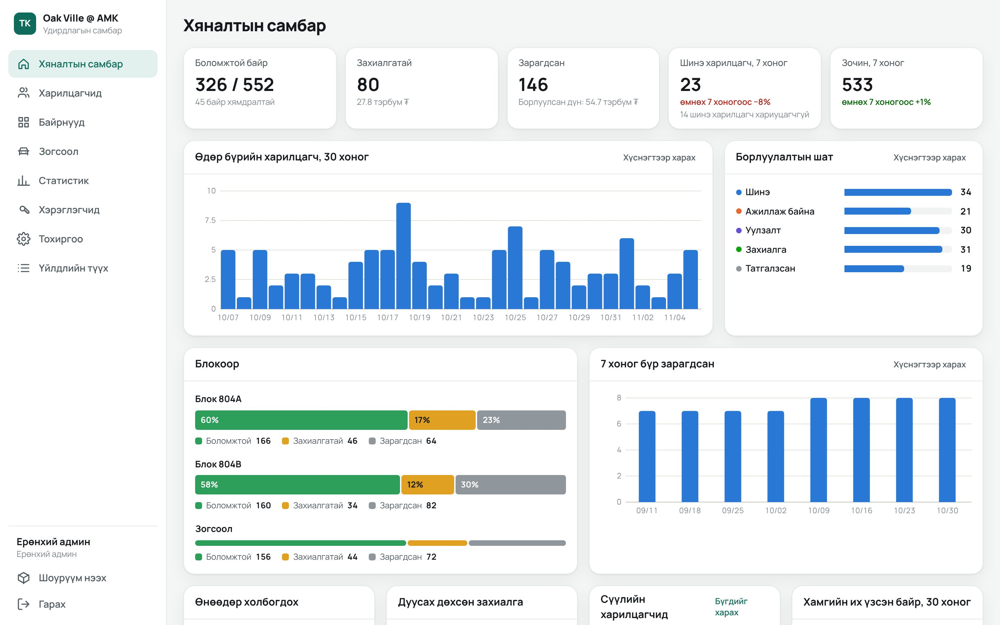

# 3D Байр Сонголт: интерактив 3D шоурүүм

[English](./README.md)

Худалдан авагч хөтөч дээрээ орон сууцны төслийг үзэж, блок, давхар, айлаа сонгоод, тавилгатай өрөөнүүдийг өдрийн дурын цагт харж, үзлэгт бүртгүүлэх эсвэл утасны дугаараа үлдээнэ. Борлуулалтын баг удирдлагын самбараас эдгээр хүсэлттэй ажиллаж, айл бүрийн төлөв, үнийг тохируулж, худалдан авагчид юу үзэж байгааг хардаг.

Жишээ төсөл нь Oak Ville @ AMK (804A, 804B блок, 552 айл). Бүх зүйл өгөгдлөөс үүсдэг тул шинэ төсөлд код өөрчлөх биш, зөвхөн шинэ өгөгдөл, файл хэрэгтэй.

## Ажиллуулах

Clone хийсний дараа Windows дээр `start.bat` файлыг давхар дарна, Mac эсвэл Linux дээр `./start.sh` ажиллуулна. Энэ нь 3D файлуудыг татаж, сангуудыг суулгаж, автомат sync-ийг асаагаад http://localhost:5173 хаягийг нээнэ. Удирдлагын самбар хамт http://localhost:5175/admin/ хаягт асна; анх удаа цонхонд хэвлэгдсэн тохиргооны кодоор бүртгэлээ үүсгэнэ. Өгөгдлийн сан нь тухайн компьютерийн `data/` хавтаст үлдэнэ (худалдан авагчийн дугаар агуулдаг тул sync хийгддэггүй), тиймээс онлайн гаргах хүртэл компьютер бүр өөрийн сантай (доор үз). Зөвхөн шоурүүмийг асаах бол `--no-admin` нэмнэ. Шаардлага нь зөвхөн [Git LFS](https://git-lfs.com)-тэй Git, Node 22 буюу түүнээс шинэ хувилбар. Windows дээр Node байхгүй бол `start.bat` өөрөө суулгана.

Гараар бол `pnpm install`, дараа нь `pnpm dev`. PowerShell скрипт ажиллуулахыг хориглосон гэж гарвал `pnpm`-ийн оронд `pnpm.cmd` гэж бичнэ. Маркетингийн сайтыг `pnpm dev:website`, удирдлагын самбарыг `pnpm dev:admin` командаар ажиллуулна (доор үз).

| Команд | Юу хийдэг |
|---|---|
| `pnpm test` | Нэгжийн тест: үнэ, боломжит байдал, зай, цэгүүд, холбоос, рендерийн өгөгдөл |
| `pnpm typecheck` | Бүх багцын TypeScript шалгалт |
| `pnpm lint` | ESLint |
| `pnpm build` | Аппуудыг `dist/` руу бүтээнэ: сайт `/`, шоурүүм `/showroom/`, удирдлагын самбар `/admin/` |
| `pnpm dev:admin` | API-г :8787 дээр, удирдлагын самбарыг http://localhost:5175/admin/ дээр асаана |
| `pnpm dev:all` | Дээрхийг, мөн шоурүүм, сайтыг хүсэлт, статистикаа локал API руу илгээдэгээр асаана |
| `pnpm demo:data` | Локал санг зохиомол худалдан авагч, борлуулалт, зургаан долоо хоногийн үзэлтээр дүүргэнэ (зөвхөн локал) |
| `pnpm cf:setup`, `pnpm cf:deploy` | Бүгдийг Cloudflare-ийн үнэгүй багц дээр онлайн байршуулна (доор үз) |
| `pnpm build:online`, `pnpm start:server` | Бүгдийг нэг хаягт зориулж бүтээгээд API-тай хамт энэ компьютероос үйлчилнэ |
| `pnpm --filter @bair/showroom e2e` | Ажиллаж буй сервер дээр худалдан авалтын урсгалыг хөтчөөр шалгана (Edge эсвэл Chrome) |
| `pnpm --filter @bair/showroom assets` | CC0 файлуудыг дахин татаж шахна |

Шууд холбоосууд: `#/804A`, `#/804A/12`, `#/804A/12/325`, `#/804A/12/325/living-1`, `#/outdoor/playground`. Өдрийн цагийг `?t=18:30` гэж нэмнэ.

Хөгжүүлэгчийн хуудсууд: айл дотор `?debug=1` нь хэмжсэн төлөвлөгөө, зайг харуулна, `#/dev/plan/4R` нь дээрээс харсан зургийг төлөвлөгөөтэй харьцуулна, `#/dev/export` нь Unreal руу экспортолно.

## Бүтэц

| Хавтас | Агуулга |
|---|---|
| `apps/showroom` | 3D апп |
| `apps/website` | Түр маркетингийн сайт |
| `apps/admin` | Удирдлагын самбар (React), `/admin/` хаягт |
| `apps/api` | Самбарын API: Cloudflare Worker ба D1, эсвэл компьютер дээр Node ба SQLite |
| `packages/project-data` | Төслийн тохиргоо, өгөгдөл, интерьер, үнэ, боломжит байдал, монгол текст. 3D код байхгүй тул backend ашиглаж болно |
| `packages/ui` | Шилэн самбар |
| `unreal` | Бодит зураг гаргах дамжлага, [тайлбар](./unreal/README.md) |
| `reference` | Эх зураг, интерьер дизайны PDF |
| `docs` | Интерьерийн тэмдэглэл, Blender заавар, шалгалтын зургууд |
| `vault` | Obsidian тэмдэглэл: одоогийн зорилт, session-ий тэмдэглэл, шийдвэр, санаа |

## Шинэ төсөл нэмэх

Бүгд `packages/project-data/src` дотор байна:

1. `data/project.config.ts`: нэр, хөгжүүлэгч, холбоо барих мэдээлэл, өнгө, өргөрөг, уртраг, цагийн бүс, м² үнэ, давхрын нэмэгдэл, зогсоолын үнэ.
2. `data/blocks.ts`: блокууд, давхар бүрийн байрлал.
3. `data/unitTypes.ts`, `interiors/`: айлын төрөл бүрт нэг файл (өрөө, хаалга, цонх, тавилга, гэрэл, цэгүүд). `pnpm test` ажиллуулахад багтахгүй зүйлийг мэдээлнэ. Тавилгыг хэзээ ч багтаах гэж жижигрүүлэхгүй: бодит зөрчлийг `interiors/exceptions.ts` дотор бичнэ.
4. `data/site.ts`, `data/outdoor.ts`, `data/garage.ts`, `data/cameras.ts`: тохижилт, гадаа үзэх цэгүүд, зогсоол, камерууд.
5. `i18n/mn.ts`: текстүүд. Шинэ хэл нэмэхдээ энэ файлыг `en.ts` болгон хуулж орчуулна.

## Удирдлагын самбар

Борлуулалтын багийн хэсэг, монгол хэлээр, `/admin/` хаягт:

- **Хяналтын самбар:** боломжтой, захиалгатай, зарагдсан айлууд ба дүн, энэ болон өмнөх долоо хоногийн шинэ харилцагч, зочин, өдөр бүрийн хүсэлт, борлуулалтын шат, блок бүрийн төлөв, долоо хоног бүрийн борлуулалт, өнөөдөр холбогдох хүмүүс, дуусах дөхсөн захиалга, сүүлийн хүсэлтүүд, хамгийн их үзсэн айлууд.
- **Харилцагчид:** шоурүүм, вэбсайтаас ирсэн бүх хүсэлт, мөн утсаар болон биечлэн ирсэн хүмүүсийг гараар нэмнэ. Төлөв, эх сурвалж, хариуцагч, огноо, хугацаа болсон эсэхээр шүүж, нэр, дугаар, айлаар хайна. Хүснэгт эсвэл төлөв бүрээр баганалсан самбар дээр ажиллана (картыг чирж шилжүүлнэ): шинэ, ажиллаж байна, уулзалт, захиалга, татгалзсан. Харилцагч бүрт хариуцагч, дараагийн алхмын огноо, тэмдэглэл ба өөрчлөлтийн түүх, хүсэлт илгээхээсээ өмнө шоурүүмд юу үзсэн нь, ижил дугаартай бусад хүсэлт харагдана. Нэг товчоор тэр айлыг захиалгатай эсвэл зарагдсан болгоно.
- **Байрнууд:** блок бүрийн давхар × байрны зураглал, төлөв, сонирхол (айл бүрийг хэдэн зочин үзсэн) эсвэл төрлөөр өнгөлөгдөнө. Айлуудыг нэг нэгээр, хүрээгээр, давхраар эсвэл баганаар сонгоод төлөвийг нь өөрчлөх, тодорхой огноо хүртэл хувиар хямдрал тавих, хямдрал цуцлах, жагсаалтын үнийг өсгөх, бууруулна. Айл бүр өөрийн хуудастай: төлөв, захиалгын хугацаа, захиалсан харилцагч, гараар тавьсан үнэ эсвэл тогтмол хямдралтай үнэ, тэмдэглэл, түүх, харилцагчид. Шоурүүм шинэ төлөвийн өнгө, хямдралтай үнийг (хуучин үнийг зурж) хоёр минутын дотор харуулна.
- **Зогсоол:** гараажийн 272 зогсоолд мөн адил.
- **Статистик:** өдөр бүрийн зочин, блок бүрийн давхар тус бүрийн сонирхлын дулааны зураг, хамгийн их үзсэн айл, блок, төрөл, өрөө, гадна талбай, төхөөрөмж, цаг, үйлдэл (төлөвлөгөө үзсэн, залгасан, хуваалцсан), шоурүүм нээснээс хүсэлт илгээх хүртэлх зам. График бүрийг хүснэгтээр харж болно.
- **CSV, Excel экспорт:** харилцагч (одоогийн шүүлтүүрээр), айл, зогсоол, статистик.
- **Хэрэглэгчид, Тохиргоо, Үйлдлийн түүх:** бүртгэлүүд, 1 м²-ийн үндсэн үнэ, давхрын нэмэгдэл, зогсоолын үнэ, нууц үг солих, хэн юуг өөрчилж, экспортолсон түүх.

Бусад зураг (зохиомол өгөгдөл): [байрны зураглал](docs/admin/units.jpg), [харилцагчийн самбар](docs/admin/leads-board.jpg), [нэг харилцагч](docs/admin/lead.jpg), [статистик](docs/admin/analytics.jpg), [утсан дээрх зураглал](docs/admin/phone-units.jpg).

| Эрх | Хийж чадах зүйл |
|---|---|
| Ерөнхий админ | Бүгдийг, үүнд хэрэглэгч, үндсэн үнэ, харилцагч устгах, үйлдлийн түүх |
| Админ | Харилцагч, айл, зогсоолын төлөв, үнэ, хямдрал, экспорт |
| Борлуулалтын ажилтан | Бүх харилцагчтай ажиллана (өөрийн нэмсэн нь өөрт оноогдоно), айл, зогсоол, статистикийг харна |

Анх нээхэд самбар тохиргооны код асууж, эхний ерөнхий админыг үүсгэнэ. `pnpm dev:admin` уг кодыг терминалд, Cloudflare дээр `pnpm cf:deploy` хэвлэж өгнө. Хэн ч нэвтэрч чадахгүй болбол `pnpm --filter @bair/api user password <имэйл>` шинэ нууц үг тавина (Cloudflare дээр ажиллуулах SQL-ийг `--sql` нэмж авна).

Нууц үг бичсэн хэвээрээ хөтчөөс гардаггүй: хөтөч PBKDF2-оор (600,000 удаа) сунгаад, сервер зөвхөн үр дүнгийн hash-ийг хадгална. Нэвтрэлт нь `/api`-д зориулсан HttpOnly cookie, таван удаа буруу нууц үг оруулбал бүртгэл 15 минут түгжигдэнэ, самбарын бичих хүсэлт бусад сайтын илгээж чадахгүй толгойтой.

Үзэлтийн статистик нэргүй: хөтчийн таб бүрт санамсаргүй дугаар, cookie байхгүй, хянуулахгүй гэж хүссэн хөтчөөс юу ч бичихгүй.

## Үнэгүй онлайн байршуулах

Cloudflare-ийн үнэгүй багц бүгдийг кредит карт шаардахгүйгээр ажиллуулна: сайт, шоурүүм, удирдлагын самбарыг статик файлаар (үнэгүй, хязгааргүй), API-г D1 өгөгдлийн сантай Worker-ээр. Төсөл ямар ч төлбөртэй үйлчилгээ дууддаггүй.

1. https://dash.cloudflare.com/sign-up хаягаар үнэгүй бүртгэл үүсгэнэ.
2. `pnpm cf:setup` нэвтрүүлж (хөтөч нээгдэнэ), өгөгдлийн санг үүсгэнэ. `apps/api/wrangler.jsonc` руу бичсэн сангийн дугаарыг commit хийнэ.
3. `pnpm cf:deploy` бүгдийг бүтээж нийтэлнэ. Хаягийг (`https://bair-songolt.<таны-нэр>.workers.dev`), анх удаа бол `/admin/` дээрх эхний админы тохиргооны кодыг хэвлэнэ.

Хамгийн сүүлийн кодыг онлайн гаргах бүрт `pnpm cf:deploy`-г дахин ажиллуулна. Өөрийн домэйныг Cloudflare-ийн самбараас нэмнэ (Workers → bair-songolt → Domains).

Үнэгүй багцын өдрийн хязгаар: API руу 100,000 хүсэлт, 5 сая мөр унших, 100,000 мөр бичих. API эдгээрээс хол байхаар хийгдсэн: шоурүүмийн нэг зочин хэдхэн хүсэлт зарцуулна, статистик өдрийн тоолуураар хадгалагдана, статистик өдөрт ихдээ 60,000 бичилт хийх тул хүсэлт үргэлж хадгалагдана. Маш их зочинтой өдөр энэ хязгаарт хүрвэл статистик UTC шөнө дунд хүртэл тоолохоо зогсоож, хүсэлтүүд хэвийн ажилласаар байна.

3D файлуудыг GitHub Pages дээр үлдээх бол Pages deploy-оос өмнө репозиторийн `API_URL` хувьсагчид Cloudflare хаягийг өгнө. Ингэвэл шоурүүм, сайт хүсэлт, статистикаа тийш илгээнэ.

**Эсвэл өөрийн компьютер дээр:** `pnpm build:online`, дараа нь `pnpm start:server` сайт, самбар, API-г http://localhost:8787 дээр ажиллуулна, өгөгдлийн сан `data/bair.sqlite` (Git-д ордоггүй, нөөцлөөрэй). Энэ ч үнэгүй, гэхдээ компьютер асаалттай, интернетээс хандах боломжтой үед л худалдан авагчид хүрнэ.

## Хүсэлт, шууд үнэ, статистик

Шоурүүмийн бүх маягт `apps/showroom/src/lib/leads.ts` доторх `submitLead()`-ээр, сайтын холбоо барих маягт `apps/website/src/App.tsx`-ээр дамжина. `VITE_API_URL`-тэй бүтээвэл (deploy командууд өөрсдөө тохируулна) хүсэлтүүд API руу очиж, шоурүүм айлын төлөв, үнийг тэндээс авч, нэргүй статистик илгээнэ. Үгүй бол бүх зүйл өмнөх шигээ ажиллана: хүсэлт хөтөч дотор үлдэж, төлөв төслийн өгөгдлөөс гарна. Илгээж чадаагүй хүсэлт хадгалагдаж, дараагийн удаа нээхэд дахин илгээгдэнэ. Өөр backend руу илгээх бол `project.config.ts` дотор `leads.endpoint`-ийг тохируулна.

## Хоёр компьютероос зэрэг ажиллах

`start.bat`-аа ажиллуулсан хэвээр байлгана, эсвэл Windows дээр `pnpm sync:install` командыг нэг удаа ажиллуулбал sync компьютертэй хамт асдаг болно. Сүүлчийн засвараас 45 орчим секундын дараа таны өөрчлөлт `main` руу commit, push хийгдэж, нөгөө талын өөрчлөлт өөрөө орж ирнэ. Зөвхөн `main` дээр ажилладаг тул өөрийн тусдаа branch-д хүрэхгүй.

| Команд | Юу хийдэг |
|---|---|
| `pnpm sync` | Яг одоо sync хийнэ |
| `pnpm sync:list` | Сүүлийн commit-уудыг харуулна |
| `pnpm sync:undo` | Нэг commit буцна. Дахин ажиллуулбал цааш буцна |
| `pnpm sync:back <commit>` | Бүх файлыг тухайн commit-ийн төлөвт буцаана |

Буцахад шинэ commit нэмэгдэж, түүх хадгалагдана. Тиймээс хоёр тал ажиллаж байхад ч аюулгүй, буцаасныг ч дахин буцааж болно.

**Хоёр тал нэг мөрийг зэрэг засвал:** sync зогсохгүй. Сүүлд sync хийсэн талын хувилбар тэр мөрөнд үлдэж, өмнөх хувилбар нь GitHub дээрх `backup/...` branch-д хадгалагдаж, `.git/sync.log`-д бичигдэнэ. Нэг файлын өөр мөрүүдийг засвал ердийнхөөрөө нийлнэ.

Sync-ийн commit-ууд Actions-ийн үнэгүй минутыг хэмнэхийн тулд CI алгасдаг бөгөөд урьдчилан шалгагддаггүй. Тиймээс дуусаагүй ажил нөгөө тал руу очиж болно. Шалгалт ажиллуулахыг хүсвэл `[skip ci]`-гүйгээр гараар commit хийнэ.

## Obsidian дахь төслийн тэмдэглэл

`vault/` бол Obsidian-ий vault. Үүнийг төсөл дээр ажилладаг хүмүүс болон cloud, компьютер дээрх Claude Code-ийн бүх session хамтдаа ашиглана. Obsidian дээр **Open folder as vault**-ыг сонгоод repository-г бүхэлд нь биш, `vault` хавтсыг нээнэ. Тэмдэглэлүүд бусад файлын адил автомат sync-ээр дамжина. `CLAUDE.md`-ийн дагуу Claude-ийн session бүр эхлээд `vault/Now.md` болон inbox-ийг уншиж, дуусахдаа `vault/Sessions` дотор тэмдэглэл үлдээнэ. Ямар нэг зүйл хүсвэл `vault/Inbox` руу тэмдэглэл бичнэ. Дэлгэрэнгүйг [vault/How this vault works.md](./vault/How%20this%20vault%20works.md)-ээс үзнэ.

## Байршуулах

GitHub Actions нь ердийн commit бүрт lint, typecheck, тест ажиллуулна. Онлайн гаргах үнэгүй арга нь дээрх Cloudflare. GitHub Pages нь public repository эсвэл төлбөртэй багц шаарддаг тул Pages-ийн байршуулалт зөвхөн **Actions** цэснээс гараар эхлүүлэхэд ажиллана. Ашиглахаас өмнө repository-н тохиргоонд **Pages → Source**-ийг **GitHub Actions** болгоно. Pages зөвхөн сайт, шоурүүмийг үйлчилнэ; удирдлагын самбарт API хажууд нь хэрэгтэй.

GitHub нь 100 MB-аас том файлыг хүлээж авдаггүй, сайтын хэмжээг ч хязгаарладаг. Бодит төсөлд рендерийн зургуудыг CDN руу байршуулж, `VITE_ASSET_BASE_URL` хувьсагчид хаягийг нь (төгсгөлд нь `/` тавьж) өгч бүтээнэ.

## Рендер ба 3D дамжлага

- **Unreal:** [unreal/README.md](./unreal/README.md) экспорт, панорама, зураг, төлөвлөгөө рендерлэх, апп дээр харуулах тухай.
- **Blender:** [docs/BLENDER_PIPELINE.md](./docs/BLENDER_PIPELINE.md) обьектын нэр, тохиргоо, экспортын заавар.

## Эх сурвалж

Файлууд CC0, [ASSETS.md](./ASSETS.md)-д жагсаасан. Барилга, айлын төлөвлөлт нь Oak Ville @ AMK товхимлоос (HDB, Сингапур) зөвхөн жишээ болгон авсан. Арилжааны зорилгоор ашиглахаас өмнө зөвшөөрөл авах эсвэл өөрийн төслөөр солино.
